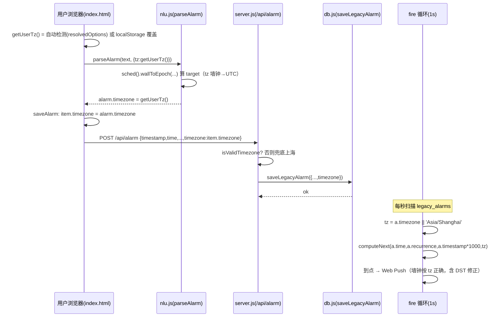
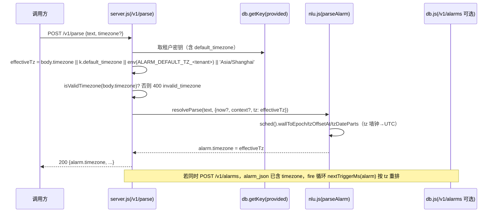

# P3 增量架构设计：用户时区真正可用化（P0 + P1，仅增量）

> 作者：架构师 高见远（Gao）｜团队：software-alarm-tz｜主理人：齐活林（Qi）
> 范围：在现有原生 Node.js + 原生前端（无框架）项目上，**仅**改动 P3 时区相关的 P0/P1 部分。
> 设计契约 `api_open_design.html`（即 openapi.yaml）已预留 `parseAlarm(text, now?, tz?)` 与 `timezone` 字段，本次为"接上实现"，**不改动设计契约结构**。

---

## 0. 现状确认（已读源码，非臆测）

| 文件 | 现状（行号） | 结论 |
|---|---|---|
| `nlu.js` | L384 `const tz = 'Asia/Shanghai'`（写死）；L350 `now` 用机器本地；L411/L450 `target` 用 `new Date(...)` 本地时间；L390/L392/L396/L423/L426/L429/L430/L439 的"今天"基准用 `now.getFullYear()` 等本地值；L504 `off = -now.getTimezoneOffset()` 本地偏移；输出已含 `timezone: tz`（L518） | **P0-1/P0-2 主战场**：未复用 scheduler，未接受 `opts.tz` |
| `scheduler.js` | L11 `tzOffsetAt`、L24 `wallToEpoch`、L34 `tzDateParts` 均已导出（`module.exports` L193 + `window.Scheduler` L198） | **无需改动**。导出已就绪，nlu 直接复用即可 |
| `server.js` | `/v1/parse` L297 只读 `text/now/context`（L298-314），**不读 `timezone`**；`/api/parse` L553 同理；`/api/alarm` L533-543 建 legacy alarm **无 `timezone` 字段**；fire 循环 L599 `const tz = a.timezone \|\| 'Asia/Shanghai'` 已读但永远取不到；`/v1/alarms` 显式路径 L389 `timezone: body.timezone \|\| 'Asia/Shanghai'` 缺租户默认；`/v1/keys` 创建 L476 无 `default_timezone` | **P0-3/P0-4/P0-5/P1-3 主战场**：透传 + 校验 + 持久化缺位 |
| `db.js` | `keys` 表 L65-76 **无 `default_timezone`**；`legacy_alarms` 表 L115-128 **无 `timezone`**（`PM 怀疑已证实`）；`alarms` 表 L89 存 `alarm_json`（已含 timezone，无需改）；`createKey` L186 无默认时区入参；`rowToKey` L149、`listLegacyAlarms` L276、`saveLegacyAlarm` L283 均未涉及 timezone | **P0-4/P1-3 持久化侧** |
| `index.html` | L166-167 脚本顺序 `nlu.js`→`scheduler.js`（注意顺序问题）；`doParse` L440 调 `parseAlarm`/`/api/parse` 不带 tz；`saveAlarm` L482 的 item **已含 `timezone: a.timezone`**；`syncAlarmToServer` L568 `'add'` 分支**不发 `timezone`**；`renderList` L294、`renderPreview` L255 **不展示时区**；`computeNextTrigger` L181 已用 `Scheduler.nextTriggerMs(a)`（读 `a.timezone`） | **P0-4 发送侧 / P1-1 / P1-2** |
| `manage_keys.js` | `create` L16-31 调 `db.createKey({tenant,label,rate_limit,plan})` 无 `default_timezone` | **P1-3 CLI 侧** |
| `openapi.yaml` | `ParseRequest.timezone` L512 已存在；`Alarm`/`AlarmCreate`/`AlarmUpdate` 均含 `timezone`；但 `KeyCreate` L752、`KeyRecord` L731 **无 `default_timezone`**；错误码表无 `invalid_timezone` | **P1-3 契约侧 + P0-3 错误码**（契约本身已预留 timezone，仅补 default_timezone） |
| `api_reference.html` | L60 时区说明为"固定 Asia/Shanghai"；L273 建 key 示例无默认时区 | **P1-3 文档侧** |
| `tests/*` | `cases.js`/`run.js` 无 tz 用例；`scheduler.js`（测试）已充分覆盖 tz/DST，无需改；`test_openapi.js` 无 tz/默认时区/非法校验用例 | **补 P0-3/P0-4/P1-3 测试** |

**核心结论**：时区换算能力（scheduler.js）早已就绪且被 fire 循环预期；P3 的本质是把 `timezone` 作为**贯穿 nlu→server→db→fire 的一等字段**接通，并在解析端用 scheduler 替换机器本地换算。

---

## 1. 实现方案与框架选型

- **技术栈不变**：原生 Node.js（CommonJS）+ 原生前端（`<script>` 全局），**不引入任何框架/新依赖**。`package.json` 无新增依赖。
- **时区换算唯一来源**：严格复用 `scheduler.js` 的 `wallToEpoch / tzOffsetAt / tzDateParts`，**不得新造任何时区换算函数**（PRD 硬约束）。
- **双端取用 scheduler（P0-2 代码草案）**：`nlu.js` 当前是 UMD IIFE（L6 `(function(global){...})(typeof window!=='undefined'?window:this)`），Node 端 `module.exports={parseAlarm}`，浏览器端 `window.parseAlarm`。在 IIFE 顶部、`parseAlarm` 之前插入：

  ```js
  // nlu.js —— 双端取用 scheduler 时区换算（置于 IIFE 顶部，parseAlarm 之前）
  var _sched = (typeof window !== 'undefined' && window.Scheduler)
    ? window.Scheduler                                   // 浏览器：index.html 已挂 window.Scheduler
    : (typeof require === 'function' ? require('./scheduler.js') : null); // Node：同目录 require
  var wallToEpoch = _sched && _sched.wallToEpoch;
  var tzOffsetAt  = _sched && _sched.tzOffsetAt;
  var tzDateParts = _sched && _sched.tzDateParts;
  ```

  **脚本顺序修正（必要）**：当前 `index.html` L166-167 为 `nlu.js` 先于 `scheduler.js`。浏览器端 `_sched` 在 nlu 解析时已可取到 `window.Scheduler`（因为 `getScheduler` 在 `parseAlarm` 被调用时才取值——见下）。但为消除加载顺序隐患，建议把 `index.html` 两行**对调**为 `scheduler.js` 在前、`nlu.js` 在后（T4 任务内处理，且测试 `test_openapi.js` 仅断言存在 `nlu.js` 标签、不校验顺序，安全）。

  **更稳妥的惰性取法**（推荐，彻底免疫脚本顺序）：把 `_sched` 改为惰性 getter，在 `parseAlarm` 内首次需要时解析：
  ```js
  var _sched;
  function sched(){ if(_sched!==undefined) return _sched;
    _sched = (typeof window!=='undefined'&&window.Scheduler) ? window.Scheduler
           : (typeof require==='function' ? require('./scheduler.js') : null); return _sched; }
  ```
  解析端调用 `sched().wallToEpoch(...)` 等。二选一即可，推荐惰性版。

- **向后兼容（P0-5）**：`timezone` 为 `null`/未设置 → 回退 `'Asia/Shanghai'`；解析请求未带 `timezone` 时行为同 P3 前（即默认上海）。

---

## 2. 文件清单与改动点（逐文件、带行号）

| 文件 | 关键行 | 改动性质 | 说明 |
|---|---|---|---|
| `nlu.js` | L6 顶部（IIFE 内） | **新增** | 加入 §1 的双端 `sched()` 取用（惰性）。 |
| `nlu.js` | L384 | **修改** | `const tz = (opts && opts.tz) || 'Asia/Shanghai';`（取代写死）。 |
| `nlu.js` | L350 之后 | **新增** | 取 `const nowEpoch = now.getTime(); const todayTz = tzDateParts(nowEpoch, tz);`（用户在 tz 下的日历日）。 |
| `nlu.js` | L390, L392, L396, L402, L411 | **修改** | 绝对日期分支：今天基准改用 `todayTz`（UTC 日期比较）；`year/month` 补全改用 `todayTz.y/.mo`；L411 单次 `target` 改用 `new Date(wallToEpoch(year, month, day, h, minute, tz))`。 |
| `nlu.js` | L414-421（relMatch） | **不变** | 相对时长（`30分钟后`）为绝对偏移，与 tz 无关，保留。 |
| `nlu.js` | L423, L426, L429, L430, L439, L450 | **修改** | 相对日锚点分支：今天基准、星期计算（`now.getDay()`）、`base` 日期全部改用 `todayTz`（用 `Date.UTC(todayTz.y,todayTz.mo-1,todayTz.d).getUTCDay()` 取星期），`baseY/M/D` 经 UTC 加减后，L450 `target` 改用 `wallToEpoch(baseY,baseM,baseD,h,minute,tz)`。 |
| `nlu.js` | L503-508 | **修改** | ISO `datetime` 偏移改用 `tzOffsetAt(tz, target.getTime())/60000`（取代 `-now.getTimezoneOffset()`）；墙钟部分用 `tzDateParts(target.getTime(), tz)` 重组，确保显示的是 tz 墙钟。 |
| `scheduler.js` | 全文 | **不变** | 导出已含所需函数，无需调整。 |
| `db.js` | L65-76 `keys` 表 | **修改（DDL）** | 新增列 `default_timezone TEXT DEFAULT 'Asia/Shanghai'`（存量行自动填上海，符合 P1-3 租户默认）。 |
| `db.js` | L115-128 `legacy_alarms` 表 | **修改（DDL）** | 新增列 `timezone TEXT DEFAULT 'Asia/Shanghai'`（存量行自动填上海，符合 P0-4 根因修复：L599 `a.timezone || 'Asia/Shanghai'` 终可取真值）。 |
| `db.js` | L149-157 `rowToKey` | **修改** | 返回对象增加 `default_timezone: r.default_timezone \|\| null`。 |
| `db.js` | L186-194 `createKey` | **修改** | 签名增 `default_timezone`；INSERT 含该列。 |
| `db.js` | L276-281 `listLegacyAlarms` | **修改** | 映射增加 `timezone: r.timezone \|\| null`。 |
| `db.js` | L283-290 `saveLegacyAlarm` | **修改** | INSERT 含 `timezone`（来自入参 `a.timezone`）。 |
| `db.js` | L403-414 `migrateLegacyAlarmsSchema` | **修改/新增** | 在其中追加 `ALTER TABLE legacy_alarms ADD COLUMN timezone TEXT DEFAULT 'Asia/Shanghai';`（已有函数在旧库上 ALTER，幂等）；并新增 `migrateKeysDefaultTz()` 对 `keys` 表 `ALTER TABLE keys ADD COLUMN default_timezone TEXT DEFAULT 'Asia/Shanghai';`，启动时调用。 |
| `server.js` | L297-321 `/v1/parse` | **修改** | 读 `body.timezone`；若提供且非法 IANA → `400 invalid_timezone`；有效则 `effectiveTz = body.timezone`，否则 `effectiveTz = k.default_timezone \|\| process.env['ALARM_DEFAULT_TZ_'+k.tenant] \|\| 'Asia/Shanghai'`；把 `tz: effectiveTz` 传入 `resolveParse` 的 opts（改写 L314）。 |
| `server.js` | L251 `resolveParse` | **不变（透传）** | 已 `parseAlarm(text, opts)`，opts.tz 自动透传。 |
| `server.js` | L368-412 `/v1/alarms` POST | **修改** | 顶部计算 `effectiveTz`（同上 fallback 链）；解析路径 L380 传入 `tz: effectiveTz`；显式路径 L389 `timezone: body.timezone \|\| k.default_timezone \|\| 'Asia/Shanghai'`；PATCH 分支 L439 若提供 `body.timezone` 先校验 IANA 再赋值。 |
| `server.js` | L533-547 `/api/alarm` | **修改** | 构建 legacy alarm 时增加 `timezone: (isValid(body.timezone)? body.timezone : 'Asia/Shanghai')`（前端只发合法 IANA，故恒合法；非法兜底上海）；传入 `saveLegacyAlarm`。 |
| `server.js` | L553-562 `/api/parse` | **修改** | 读 `body.timezone`；非法 → `400 invalid_timezone`（appError）；否则 `tz = body.timezone \|\| 'Asia/Shanghai'`，传入 `resolveParse` opts（改写 L560）。 |
| `server.js` | L597-630 legacy fire 循环 | **不变（已就绪）** | L599 `const tz = a.timezone \|\| 'Asia/Shanghai'` 一旦持久化写入即生效。 |
| `server.js` | L476-479 `/v1/keys` POST | **修改** | 调 `db.createKey({..., default_timezone: body.default_timezone \|\| null})`。 |
| `server.js` | 新增辅助 | **新增** | 时区归一/校验助手 `normalizeTz(tz)`：若 `tz` 为 null/undefined/空串/纯空白 → 返回 `undefined`（交由回退链）；否则用 `new Intl.DateTimeFormat('en',{timeZone:tz})` 试探，抛错视为非法（调用方返回 `400 invalid_timezone`），成功则返回该 tz。所有显式携带 tz 的入口统一调用（P0-3 校验；**空串不视为非法、走回退**，按 PM 拍板）。 |
| `index.html` | L166-167 | **修改** | 脚本顺序对调：`scheduler.js` 在前、`nlu.js` 在后（配合 §1）。 |
| `index.html` | 新增 `getUserTz()` | **新增** | `Intl.DateTimeFormat().resolvedOptions().timeZone` 自动检测；localStorage `alarm_agent_tz` 手动覆盖优先；回退 `'Asia/Shanghai'`。 |
| `index.html` | L440-470 `doParse` | **修改** | 本地 `parseAlarm(text, {...opts, tz: getUserTz()})`；`/api/parse` fetch body 增 `timezone: getUserTz()`。 |
| `index.html` | L565-571 `syncAlarmToServer` | **修改** | `'add'` 分支 body 增 `timezone: item.timezone \|\| getUserTz()`。 |
| `index.html` | L255/L294 | **修改（P1-2）** | 预览卡与列表项展示时区（城市/缩写，如 `America/New_York`→`纽约 EDT` 或直显 IANA），"下次触发"已由 `computeNextTrigger` 按 `a.timezone` 给出。 |
| `index.html` | 新增设置块（P1-1） | **新增** | 偏好面板：用 `Intl.supportedValuesOf('timeZone')`（不可用则内置 IANA 列表）做搜索选择覆盖自动检测，存 `localStorage`；提供"恢复自动"。 |
| `manage_keys.js` | L16-31 | **修改** | `create` 支持 `--default-timezone <IANA>`，传入 `db.createKey({..., default_timezone})` 并在回显中打印。 |
| `portal.html` | L87-93 / L186-190 | **修改（P1-3）** | 密钥创建表单增加"默认时区"输入，写入 `body.default_timezone`。 |
| `openapi.yaml` | L731 `KeyRecord`、L752 `KeyCreate` | **修改** | 各增 `default_timezone`（string，nullable，默认 Asia/Shanghai，说明"租户级默认时区，缺省回退上海"）。 |
| `openapi.yaml` | 错误码表 | **修改** | 在 `BadRequest` 示例补充 `invalid_timezone`；`info.version` 建议升至 `1.5.0`（或 `1.4.1`，由主理人定）。 |
| `api_reference.html` | L60 | **修改** | 时区说明改为："缺省 Asia/Shanghai；解析/建闹钟可传 timezone 覆盖；开放 API 未传时回退顺序 = 请求 timezone > 租户 default_timezone > Asia/Shanghai。" |
| `api_reference.html` | L273-278 | **修改** | 建 key 示例增 `default_timezone`。 |
| `README.md` | 特性段 | **修改** | 在"时区与夏令时安全"条目补充"用户自身时区为触发唯一基准，与部署时区解耦"。 |
| `tests/cases.js` | 新增用例 | **新增** | 增加带 `tz` 的用例（如 `tz:'America/New_York'`）+ `expect.tz`；可选 1 例用 `now`+`tz` 校验跨时区日期差。 |
| `tests/run.js` | L13-14 | **修改** | `check` 组装 opts 时若有 `c.tz` 则带 `tz`；新增 `if(e.tz) assert(a.timezone===e.tz)` 等断言。 |
| `tests/scheduler.js` | — | **不变** | 已充分覆盖 tz/DST，无需改（属已验证资产）。 |
| `test_openapi.js` | 新增用例 | **新增** | ① `/v1/parse` 带 `timezone:'America/New_York'`→`alarm.timezone` 正确且 timestamp 与 scheduler 推导一致；② 非法 `timezone`→`400 invalid_timezone`；③ `/api/alarm` 带 `timezone`→`db.listLegacyAlarms()` 含该值；④ `/v1/keys` 建带 `default_timezone` 后 `/v1/parse` 不传时回退租户默认；⑤ `ALARM_DEFAULT_TZ_<tenant>` 兜底。 |

---

## 3. 数据模型 / 接口变更（JSON schema 草图）

### 3.1 `/v1/parse`、`/api/parse` 请求体（契约已含 `timezone`，仅服务端补读）
```jsonc
// 已有（openapi ParseRequest），无需改结构：
{ "text": "明天8点开会", "timezone": "America/New_York", "now": "2026-10-09T12:00:00+08:00" }
// 服务端行为：timezone 省略 → 回退链（见 §7）；非法 IANA → 400 invalid_timezone
```

### 3.2 `/api/alarm` 请求体（参考 App 创建，新增 `timezone`）
```jsonc
// 现有字段：clientId, id, timestamp, time, recurrence, label, lead_minutes, end, fired_count
// 新增（可选，缺省 Asia/Shanghai）：
{ "clientId": "c123", "id": "al1", "timestamp": 1760563200, "time": "08:00",
  "recurrence": "none", "label": "起床", "timezone": "America/New_York" }
```

### 3.3 `legacy_alarms` 表（db.js）新增列 + 迁移 SQL
```sql
ALTER TABLE legacy_alarms ADD COLUMN timezone TEXT DEFAULT 'Asia/Shanghai';   -- 存量行自动填上海，符合 P0-4 根因修复
```
行对象新增 `timezone` 字段（`listLegacyAlarms`/`saveLegacyAlarm` 已列于 §2）。

### 3.4 `keys` 表（db.js）新增列 + 迁移 SQL
```sql
ALTER TABLE keys ADD COLUMN default_timezone TEXT DEFAULT 'Asia/Shanghai';   -- 存量行自动填上海；NULL 仍按上海回退
```
`rowToKey` / `createKey` / `KeyRecord` / `KeyCreate` 同步（§2）。

### 3.5 返回体 `KeyRecord` / `KeyCreate`（openapi 新增 `default_timezone`）
```jsonc
// KeyRecord 增加：
{ "key":"sk_live_...", "tenant":"demo", "label":"生产", "enabled":true,
  "rate_limit":600, "plan":"pro", "default_timezone":"America/New_York", "created_at":"..." }
// KeyCreate 请求体增加：
{ "label":"生产", "plan":"pro", "default_timezone":"America/New_York" }
```

### 3.6 新增错误码
```
400 invalid_timezone  —— 请求体携带的 timezone 不是合法 IANA 名（仅当显式提供时校验；不提供则走回退链）
```

---

## 4. 程序调用流程（时序草图）

### 4.1 参考 App 创建闹钟 → 带 tz → 服务端持久化 → fire 按 tz 触发


### 4.2 开放 API 解析带 tz → 存储/触发（含租户默认回退）


---

## 5. 有序任务列表（含依赖 + 验收要点）

> 全部为**增量改动**到已有文件；无新脚手架（故不套用"项目基础设施"模板任务）。共 5 个任务，符合 ≤5 上限。

### T1 — nlu.js 双端时区换算 + parseAlarm 接受 tz（P0-1, P0-2）
- **源文件**：`nlu.js`（必要时 `index.html` 脚本顺序在 T4 处理）
- **依赖**：无
- **优先**：P0
- **验收要点**：
  1. `nlu.js` 通过惰性 `sched()` 在 Node（`require('./scheduler.js')`）与浏览器（`window.Scheduler`）两端取到 `wallToEpoch/tzOffsetAt/tzDateParts`。
  2. `parseAlarm(text, {tz:'America/New_York'})` 的单次/相对日锚点（明天/下周/大后天）`timestamp` 与 `datetime` 墙钟落在纽约时区；未传 tz 时等同上海（向后兼容）。
  3. 全程**不出现**新的 `Intl`/自建时区换算函数，仅调用 scheduler。
  4. `node tests/run.js` 全绿（含新增 tz 用例）。

### T2 — db.js 模式扩展：legacy_alarms.timezone + keys.default_timezone（P0-4 持久化侧, P1-3 持久化侧）
- **源文件**：`db.js`
- **依赖**：无（可独立于 T1 并行）
- **优先**：P0/P1
- **验收要点**：
  1. 启动对已有库执行 `ALTER TABLE legacy_alarms ADD COLUMN timezone TEXT;` 与 `ALTER TABLE keys ADD COLUMN default_timezone TEXT;`（幂等，旧库 ALTER 补齐）。
  2. `createKey({default_timezone})` 写入并 `rowToKey` 回读；`saveLegacyAlarm` 持久化 `timezone`，`listLegacyAlarms` 回读。
  3. `node test_openapi.js` 中新建 key 带 default_timezone 可回读；legacy alarm 带 timezone 入库后可查到。

### T3 — server.js 透传、校验与租户默认回退（P0-3, P0-4, P0-5, P1-3）
- **源文件**：`server.js`
- **依赖**：T1（nlu 支持 opts.tz）、T2（db 含 default_timezone / legacy timezone）
- **优先**：P0
- **验收要点**：
  1. `/v1/parse`、`/api/parse` 读取 `body.timezone`；显式非法 IANA → `400 invalid_timezone`；省略 → 回退链（请求 > 租户 `default_timezone` > `ALARM_DEFAULT_TZ_<tenant>` > 上海）后传入 `resolveParse({tz})`。
  2. `/api/alarm` 接收并持久化 `timezone`（缺省上海）。
  3. `/v1/alarms` POST 解析/显式两条路径及 PATCH 的 `timezone` 均生效；`/v1/keys` 创建接受 `default_timezone`。
  4. legacy fire 循环在 `a.timezone` 写入后按该时区触发（含 DST）。
  5. `node test_openapi.js` 全绿（含 4.2 链路与新增用例）。

### T4 — index.html 检测/发送/展示 + 偏好面板（P0-4 发送侧, P1-1, P1-2）
- **源文件**：`index.html`（含对调 `scheduler.js`/`nlu.js` 顺序，配合 T1）
- **依赖**：T1（parseAlarm 支持 tz）
- **优先**：P1（发送侧为 P0）
- **验收要点**：
  1. `getUserTz()` 用 `Intl.DateTimeFormat().resolvedOptions().timeZone` 自动检测，`localStorage('alarm_agent_tz')` 覆盖优先；`doParse` 本地解析与 `/api/parse` 均带 `timezone`；`syncAlarmToServer('add')` 发送 `timezone`。
  2. P1-2：列表项与预览卡展示时区，"下次触发"按各自时区显示（复用 `Scheduler.nextTriggerMs`）。
  3. P1-1：偏好面板用 `Intl.supportedValuesOf('timeZone')` 搜索选择覆盖值，存 `localStorage`，提供"恢复自动"。
  4. 参考 App 在部署于 UTC 容器时，创建的闹钟按用户时区正确触发（手动验证或 E2E）。

### T5 — 文档与测试（P1-3 文档侧 + 全量回归）
- **源文件**：`openapi.yaml`、`api_reference.html`、`README.md`、`manage_keys.js`、`portal.html`、`tests/cases.js`、`tests/run.js`、`test_openapi.js`（`tests/scheduler.js` 不动）
- **依赖**：T1, T2, T3, T4
- **优先**：P1
- **验收要点**：
  1. `openapi.yaml` 的 `KeyRecord`/`KeyCreate` 含 `default_timezone`；错误码表含 `invalid_timezone`；`info.version` 建议升至 `1.5.0`。
  2. `api_reference.html` L60 时区说明与建 key 示例更新；`README.md` 特性段补充；`manage_keys.js` 支持 `--default-timezone`；`portal.html` 建 key 表单含默认时区。
  3. `tests/cases.js`+`run.js` 新增 tz 用例全绿；`test_openapi.js` 新增 P0-3/P0-4/P1-3 用例全绿；`npm test` 全绿。

---

## 6. 依赖包
- **无新依赖**。仅用 Node 内置（`Intl`、`crypto`、`node:sqlite` 已在用）与浏览器原生 `Intl.DateTimeFormat().resolvedOptions()` / `Intl.supportedValuesOf()`。`package.json` 不变。

---

## 7. 共享约定
1. **IANA 校验/归一集中在一处**：`server.js` 提供 `normalizeTz(tz)`——null/undefined/空串(`""`)/纯空白 → 返回 `undefined`（走回退链，**空串不视为非法**）；非空串用 `new Intl.DateTimeFormat('en',{timeZone:tz})` 试探，抛错即非法 → 调用方返回 `400 invalid_timezone`。所有"显式携带 timezone"的入口（/v1/parse、/api/parse、/api/alarm、/v1/alarms 及其 PATCH）统一调用。
2. **字段名统一为 `timezone`**：贯穿 nlu→server→db→fire，不做别名；`default_timezone` 仅用于租户级默认，不与记录级 `timezone` 混淆。
3. **tz 透传链**：`请求 timezone` →（缺失时）`租户 keys.default_timezone` →（缺失时）`环境变量 ALARM_DEFAULT_TZ_<tenant>` →（缺失时）`Asia/Shanghai`。该链只在服务端（/v1/*）生效；参考 App（/api/*）无租户概念，缺省上海。
4. **时区换算唯一来源 `scheduler.js`**：任何墙钟↔UTC、偏移、日历日拆分均调用 `wallToEpoch/tzOffsetAt/tzDateParts`，严禁新造。
5. **向后兼容硬规则**：`timezone` 为 `null`/未设置/缺失 → 上海；解析请求不带 timezone 时行为与 P3 前一致（默认上海）。

---

## 8. 待明确事项（需主理人/用户拍板，勿擅自决定）

> **✅ 已闭合（PM 高认可拍板）**：① `legacy_alarms`/`keys` 缺列根因正式锁定为 P0-4/P1-3 硬前置，迁移 SQL 采用 `DEFAULT 'Asia/Shanghai'`（PRD Q5 由"推荐"升级为"确认纳入 P0-4"）；② P0-3/P0-5 非法口径采纳本设计：**显式非法 IANA → `400 invalid_timezone`；null/缺失/空串(`""`)/纯空白 → 走回退链到上海（不做"非法静默回退"）**；空串等同缺失。设计 §2/§3/§7 已据此落地。

1. ~~**P0-3 与 P0-5 的"非法"处置口径**~~ ✅ **已闭合（PM 拍板）**：显式非法 IANA → `400 invalid_timezone`；null/缺失/空串/纯空白 → 回退链到上海；不静默兜底。空串不视为非法（见 §7）。
2. **绝对日期"今天"基准的 tz 化范围**：本次把 absDate 分支的顺延"今天"也改为 `todayTz`（推荐，保证跨时区正确性）。但 `parseHoliday`（农历/阳历节日）仍用机器 `now` 的年月，**跨年边界用户可能差一天**——因节日为中国语境，建议暂不动，列为已知边界。是否要求连 `parseHoliday` 也 tz 化？
3. **`portal.html` 是否纳入 P1-3**：PRD 文件清单未点名 `portal.html`，但"配置入口 /v1/keys"的可用化需要门户表单也支持 `default_timezone`。设计已纳入 T5，请确认。
4. **版本号**：`openapi.yaml` `info.version` 当前 `1.0.0`（描述却提 v1.4）。建议 P3 升至 `1.5.0`（或 `1.4.1`）。请主理人定。
5. **`ALARM_DEFAULT_TZ_<tenant>` 环境变量兜底**：PRD 提及"考虑"。设计已在服务端回退链中实现（`process.env['ALARM_DEFAULT_TZ_'+k.tenant]`），是否作为正式能力写入文档/README？建议写入。
6. **测试对 fire 循环 tz 的覆盖深度**：`test_openapi.js` 可直接验证 legacy alarm 持久化 `timezone` 与"创建过去时间 + 指定非上海 tz"的触发，但 DST 切换日的 fire 行为建议由 `tests/scheduler.js` 既有用例间接保证（不新增复杂 E2E）。是否够？
